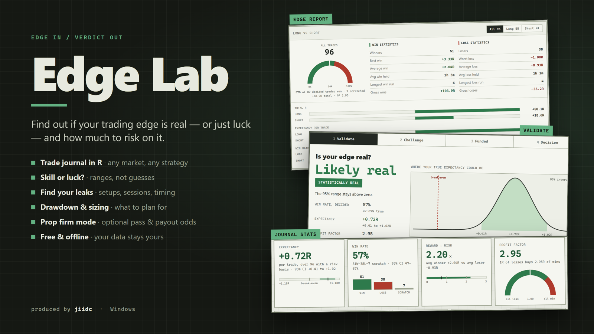

# Edge Lab

**Is your trading edge real, or just luck? And how much should you risk on it?**

Edge Lab is a trade journal and edge simulator for any strategy and any market. It measures everything
in R, tells you how sure your own record lets you be, and shows the drawdown and position size to plan
for. If you trade a funded account, an optional prop-firm mode runs your trades against your firm's
rules.

Offline and file-based: no account, no server, no telemetry. Produced by **jiidc** · MIT licensed.

**Edge Lab is free. If you paid for it, you were scammed.** The only official download is this
repository.



## Download

| | Installer (latest version) |
|---|---|
| **Windows** 10 / 11 | [**Edge-Lab-Windows-Setup.exe**](https://github.com/jiifx/edge-lab/releases/latest/download/Edge-Lab-Windows-Setup.exe) |
| **macOS** 11.3+ (Apple Silicon and Intel) | [**Edge-Lab-macOS.dmg**](https://github.com/jiifx/edge-lab/releases/latest/download/Edge-Lab-macOS.dmg) |
| Browser version (no install) | [Edge-Lab-browser.zip](https://github.com/jiifx/edge-lab/releases/latest/download/Edge-Lab-browser.zip): unzip, open `Edge Lab.html` |
| Sample journal (optional) | [sample-1000-trades.json](https://github.com/jiifx/edge-lab/releases/latest/download/sample-1000-trades.json) |

These links always fetch the newest release. Older versions, release notes and SHA-256 checksums are on
the [releases page](https://github.com/jiifx/edge-lab/releases).

### First launch

The installers are free and not code-signed (signing costs money every year), so Windows and macOS warn
the first time. **You never need to turn off Microsoft Defender or any antivirus.** Only download from
the links above.

**Windows**
1. **Browser download warning** (sometimes). Edge: *"isn't commonly downloaded"* → **⋯** → **Keep** →
   **Show more** → **Keep anyway**. Chrome: **Keep**.
2. **"Windows protected your PC"** (SmartScreen) → **More info** → **Run anyway**. This is the usual
   one, and it only appears for the first install of each version.
3. **"Smart App Control blocked an app"** (some new Windows 11 PCs). This has no Run anyway button, and
   turning Smart App Control off cannot be undone without reinstalling Windows, so don't. Use the
   browser version instead ([Edge-Lab-browser.zip](https://github.com/jiifx/edge-lab/releases/latest/download/Edge-Lab-browser.zip):
   unzip it and open `Edge Lab.html`), which needs no install.
4. If Defender ever quarantines the installer, that's a false positive. Report it at
   [microsoft.com/wdsi/filesubmission](https://www.microsoft.com/en-us/wdsi/filesubmission) and open an
   issue here. Don't switch Defender off.

**macOS**
- **macOS 14 Sonoma and earlier:** right-click the app → **Open** → **Open**.
- **macOS 15 Sequoia and later** (right-click → Open no longer works): open the app once and click
  **Done**, then **System Settings → Privacy & Security** → scroll to *"Edge Lab was blocked"* →
  **Open Anyway** → enter your password → **Open**.
- If it says the app *"is damaged and can't be opened"*, run this once in Terminal, then open it
  normally: `xattr -cr "/Applications/Edge Lab.app"`

To update, install the new version over the old one. Your journal is not touched (see [Your data](#your-data)).

## Features

**Journal**
- Trades in R: prices, or a Risk $ and P&L, or an R value directly
- Setups, entry models, sessions, quality / mistake / market-condition tags, emotions, followed-plan
- Screenshots (paste, drag or upload), MFE/MAE, planned R:R and the full run of each winner
- Multiple accounts, optional dollar layer (starting balance + what 1R is worth)

**Stats**
- **Performance**: expectancy, win rate, reward:risk and profit factor with 95% ranges; SQN, streaks,
  Kelly, deepest drawdown, equity curve, R distribution, rolling expectancy, exit efficiency
- **Target sweep**: which R:R your own record actually supports
- **Edge report**: strengths and leaks by tag, grade, setup, session and direction
- **Timing**: by entry hour, weekday, holding time, trade of the day, and time after a loss, with a
  test for whether any bucket really stands out
- **Calendar**

**Simulator**
- **Validate**: skill or luck, with the effective sample size and forward drawdown percentiles;
  **Save as image** puts the verdict and both charts on one PNG
- **Leave out**: what happens to your edge if you stop taking one kind of trade
- Drive it from sliders, or from your journal with **Use my journal**

**Prop firm mode (optional)**
- Firm rules: static / trailing / end-of-day drawdown, daily loss, targets, min days, consistency,
  fees, payout gates
- **Challenge** pass odds, and the eval size that funds you cheapest and fastest
- **Funded** is a sizing optimizer that treats funded accounts as a business: each account is bought,
  withdraws, and ends (it breaches, the firm moves it to live, or a max life of 24 months runs out),
  then is replaced. It suggests the largest size for **99% / 95% / 90% / 80% survival** (your target
  starred), **Max payout** for firms with a dollar cap, and **Max EV** (the most expected profit per
  account after fees), each robust to your edge being an estimate, marked on the chart and one click
  to use. Payouts take the firm's **max each time** on its own schedule (or small weekly sweeps);
  sizing is **fixed %** or **cushion-based** (risk scales with distance to the drawdown floor),
  compared side by side
- **Several accounts** (up to 50): copy-traded or independent, bought the same day or staggered, ended
  accounts replaced - per account count, the size, income, fees, fee budget and the chance every
  account is down at once
- **Decision** net expected value of buying in, the budget to get all your accounts funded, and a
  plan per suggestion for your account count (eval + funded size, income, $ per $1, all-down risk)
- **Rule guard**: live distance to a bound account's drawdown floor, daily limit and target

The explanations live in the **user manual** (the **?** button in the app, or
[`guide/Edge Lab - User Manual.pdf`](guide/Edge%20Lab%20-%20User%20Manual.pdf)); the screens show the numbers.

## Try it with sample data

On an empty journal, click **Load sample journal**: 1,000 futures trades with a modest, real edge, ready
to explore. The same record is in [`samples/sample-1000-trades.json`](samples/sample-1000-trades.json)
(also attached to every release) for **Journal → Import**. Both come from one generator,
[`src/sample.ts`](src/sample.ts); `node scripts/sample.mjs` rewrites the file.

## Importing your own trades

**Import** takes an Edge Lab backup (`.json`) or a **CSV** with a header row. Only two columns are
needed: **Date** and a result, either **R** or **P&L** with a **Risk** column. Optional columns:
Exit time, Setup, Direction (long/short, buy/sell), Symbol, Account, Session, Notes, Fees. Column names
are matched loosely (`P&L`, `PnL`, `Profit` all work), a separate Time column is joined to the Date, and
comma, semicolon and tab files all read. When every date could be day/month or month/day, the app asks
instead of guessing. Re-importing the same file with **Merge** adds nothing twice.

**Imports follow Account scope.** With one account selected, everything in the file goes into that
account and **Replace** only replaces that account's trades; your other accounts are not touched. With
**All accounts** selected, the file keeps its own accounts. Replace never leaves you without a copy: the
whole journal is saved first (desktop: `exports/before-replace-*.json`, browser: a download), and Undo
puts it back. **Export backup** can save one account or all of them. Deleting trades or a whole
account can be undone too.

## Build

Prerequisites: Node 20+, Rust stable (MSVC on Windows) and the
[Tauri prerequisites](https://tauri.app/start/prerequisites/) for your OS.

```bash
npm install
npm run tauri dev       # develop
npm run build           # unit tests + type check + web build + single-file HTML
node guide/build.cjs    # the user manual PDF (bundled into the installer)
npx tauri build         # installer for the current OS
```

The frontend also runs in any browser (IndexedDB storage): `npm run dev`, or open the single-file
build `dist/EdgeLab.html`.

**Tests:** `npm test` (unit, no browser) · `npm run test:e2e` (puppeteer against the single-file build;
needs a fresh `npm run build` and Microsoft Edge) · `cd src-tauri && cargo test`.

## Stack

| Layer | Tech |
|---|---|
| Shell | Tauri 2 |
| Frontend | TypeScript + Vite, no framework, canvas charts |
| Engine | Rust Monte Carlo, with a draw-for-draw identical TypeScript fallback for browsers |
| Storage | SQLite (`journal.db`) + screenshot files |

## Your data

Your journal stays on your computer. Edge Lab has no account and no server, and it never uploads
anything.

| App | Where the journal lives |
|---|---|
| Windows | `Documents\Edge Lab\` |
| macOS | `~/Documents/Edge Lab/` (if Documents access is declined, the app uses its own app-data folder and says so on screen) |
| Browser version | Inside that browser only, so export backups often |

In that folder, `journal.db` holds your trades and settings, `images/` your screenshots, and `exports/`
your backups and saved report images. **Open folder** in the Journal takes you there. Installing,
updating or uninstalling the app never touches this folder.

Before version 2.18.6 the folder was called `PropEdgeLab`. The first time a newer version starts, it
renames that folder to `Edge Lab`, with everything in it. If the rename can't happen (for example,
another program has a file in it open), the app keeps using the old folder, says so on screen, and
tries again on the next start.

**Backups**
- **Export backup** writes one self-contained file (trades, settings and screenshots) that **Import**
  restores on any computer. The app never deletes these.
- The desktop app also makes a **weekly automatic backup** and keeps the newest 8.
- **Import → Replace** saves a copy of your current journal before changing anything, and keeps the
  newest 20 of those.

## Disclaimer

An educational model, not financial advice. Firm rules change often; verify them before paying for
anything.
